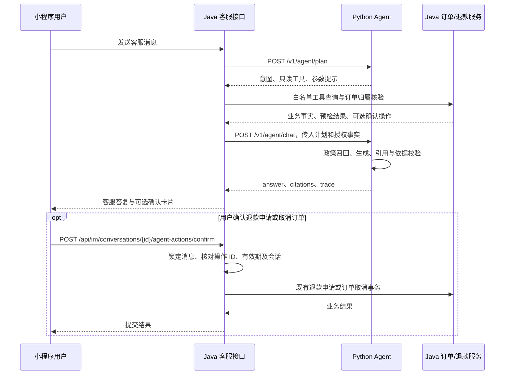

# 电商售后客服 Agent：架构与业务流程

该模块用于比赛项目中的售后客服原型。Python 负责意图与只读工具规划、政策检索和答复工作流，Java 负责用户身份、订单授权、业务查询、确认卡片及交易事务。

## 1. 服务调用链

Python 的两个接口供 Java 内部调用，小程序继续使用 Java 客服消息接口。订单查询始终以登录用户为边界，模型生成的订单号和 `business_context` 不能作为用户授权凭据。

## 2. LangGraph 节点与共享状态

| 节点 | 实际职责 |
| --- | --- |
| `route` | 校验已有计划，或通过模型结构化输出/规则生成意图、政策查询和只读工具计划 |
| `select_tool` | 确认工具类型，使用 Pydantic 校验 Java 已执行的工具结果，记录状态和缺参提示 |
| `retrieve_policy` | 对最多三个子问题并行检索，再通过 RRF 融合结果 |
| `evidence_gate` | 判断需要政策的问题是否至少召回一条证据；该判断不等同于完整覆盖所有子问题 |
| `compose` | 使用业务事实、工具结果、历史消息和政策材料生成答复；无模型时返回确定性答复 |
| `validate` | 清理未知引用 ID；对有政策证据的模型答复执行结构化 grounding 检查 |
| `repair_query` | 首次依据校验失败时改写检索查询，清空本轮证据与答复，重新检索 |
| `final_guard` | 修复后仍未通过时使用确定性兜底答复；否则返回答复 |

共享状态包括 `intent`、`tool_name`、`tool_arguments`、`missing_fields`、`tool_result`、`business_context`、`sub_queries`、`evidence`、`repair_count`、`answer`、`citations` 和 `trace`。纠错检索最多一次，避免图无限循环。

`/plan` 复用 `route` 方法产生计划；实际 Java 工具执行发生在 `/plan` 和 `/chat` 两次调用之间，不是 Python 图内的数据库操作。`select_tool` 消费工具结果，不在 Python 中重新执行查询。

## 3. 只读工具白名单

| Python 工具名 | Java 执行内容 |
| --- | --- |
| `order_lookup` | 查询本人最近五笔订单，或核验消息中的订单号并关联会话 |
| `order_status` | 查询订单状态；目前没有快递轨迹或预计送达数据 |
| `refund_status` | 查询本人订单最近的售后申请记录及处理状态 |
| `refund_precheck` | 检查订单状态、已有退款申请、商品完整性和单商家约束 |
| `cancel_precheck` | 检查订单是否为待支付/已支付，决定能否进入取消确认 |
| `product_info` | 查询会话关联商品的上架状态、价格和库存等信息 |

Pydantic 定义 `ToolArguments`、`ToolPlan`、`AuthorizedBusinessToolResult` 和 `ToolExecutionResult`。`order_no` 支持 `ORD` 加至少八位数字，`product_id` 要求为正数。当前 Java 主要消费计划中的 `tool_name`，订单号仍从原消息提取，商品从会话关联读取；不会直接信任模型提供的任意 ID。

缺少订单上下文时，Java 可以展示本人最近订单并提示用户提供订单号。绑定关系保存在业务会话中，后续消息可以继续查询；Python 的 `missing_fields` 是规划提示，不是独立的槽位补全节点或持久化记忆。

## 4. 政策 RAG

知识来源是 `agent-service/knowledge_base/*.md`。加载器按 Markdown 二级标题切片，保留标题、来源文件和片段 ID。

1. 对中文字符、相邻双字词及英文/数字词项进行分词，构建 BM25Plus 索引。
2. 通过有效词项交集过滤只因 BM25Plus 常数项而出现的弱匹配。
3. 配置 Embedding 服务时，首次查询时构建进程内文档向量；通过锁避免并发重复初始化。
4. 使用余弦相似度计算向量候选，通过带权 RRF 融合稀疏和向量排名。
5. 对复合问题的各子查询再次进行 RRF 融合，保留最终 Top-K 证据。
6. 答复引用采用 `[chunk_id]`；返回 `citations` 和节点 `trace` 供接口及客服消息展示。

该实现不依赖独立向量数据库。知识库变动后需要重新创建检索器或重启服务以重建索引。向量服务失败时回落到 BM25Plus，当前进程不会自动恢复向量通道。

## 5. 退款/取消确认与防重复

用户明确提出申请且预检通过时，Java 生成 UUID 操作 ID、订单关联、`pending` 状态及五分钟有效期，保存到客服消息的 `agentAction`。

确认接口在事务内执行：

1. 校验登录用户、会话类型与客服状态。
2. 对客服消息加行锁，验证操作 ID、操作类型和订单绑定关系。
3. 对同一个已提交操作直接返回已有状态，过期操作不再执行。
4. 对退款原因进行长度校验，设置操作为 `processing`。
5. 调用统一 `RefundApplicationService` 或 `OrderService.cancelOrder` 再次校验业务约束。
6. 更新为 `submitted`，保存业务结果并通知会话。

消息发送还支持基于请求 ID 的去重，使用 Redis 占位及结果缓存。这里的防重复保护针对同一个消息请求或确认操作；不宣称对所有入口实现全局 exactly-once，也不是 Python 独立维护的交易幂等表。退款申请提交成功仍需商家后续审核。

## 6. 故障分类和兜底

工具结果统一区分 `completed`、`missing_tool_result`、`resource_not_found`、`authorization_denied`、`business_rejected`、`timeout`、`rate_limited` 和 `backend_unavailable`。

- Java 数据查询超时与数据访问异常分别返回 `timeout`、`backend_unavailable`，不把数据库错误细节交给模型。
- `rate_limited` 是结果模型支持的状态；当前用户消息限流发生在 Java 客服入口，并不通过 Python 工具节点完成重试。
- Python 规划服务不可用时，Java 使用已有关键词路由。业务规则拒绝不应通过换参数或重试绕过。
- Java 对答复服务调用设置有限重试，并保留限流、熔断和确定性回复。只读数据库工具故障当前提示稍后重试或转人工，不自动重放查询。
- Python 的模型/Embedding 客户端有超时及有限重试设置；答复生成异常会返回 HTTP 502，再由 Java 客服链路兜底。
- grounding 校验器不可用时，当前实现回退到引用检查。它与模型判定“答复有依据”是不同路径，不能宣称所有模型答复都经过成功的事实审查。

## 7. 可观测范围与代码入口

当前 `trace` 包括节点名、状态和简短说明；Java 客服消息载荷记录业务工具状态、确认动作状态以及 Python 返回的引用和 Trace。它不是完整的工具调用审计平台，不包含独立链路追踪服务或端到端耗时看板。

| 文件 | 用途 |
| --- | --- |
| [agent-service/app/graph.py](../agent-service/app/graph.py) | LangGraph 状态与条件边 |
| [agent-service/app/tools.py](../agent-service/app/tools.py) | 工具计划、参数与结果模型 |
| [agent-service/app/knowledge.py](../agent-service/app/knowledge.py) | 知识切片、BM25Plus、向量及 RRF |
| [agent-service/app/main.py](../agent-service/app/main.py) | 规划、答复和健康检查接口 |
| [CustomerSupportAgentService.java](../backend/src/main/java/com/ecommerce/service/CustomerSupportAgentService.java) | Java 白名单工具与权限核验 |
| [CustomerSupportAgentClient.java](../backend/src/main/java/com/ecommerce/service/CustomerSupportAgentClient.java) | Java/Python HTTP 通信 |
| [ImController.java](../backend/src/main/java/com/ecommerce/controller/ImController.java) | 客服接线、确认操作与防重复 |
| [agent-service/app/evaluation.py](../agent-service/app/evaluation.py) | 离线检索命中与倒数排名计算 |

启动配置及 API 示例见 [Agent README](../agent-service/README.md)，部署见 [部署说明](../deploy/README.md#python-客服-agent)。
